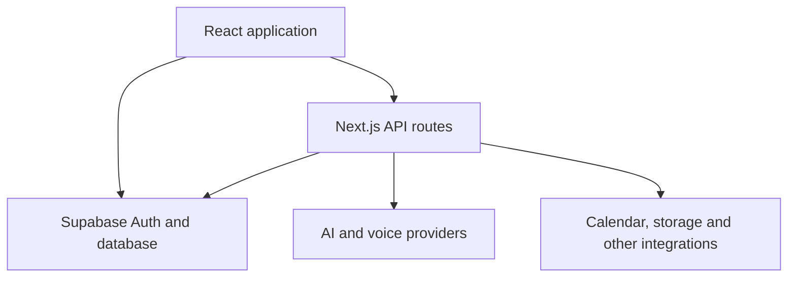

# CareerIQ

An AI-assisted career development platform built with **Next.js, TypeScript and Supabase**. The application brings together learning roadmaps, interview preparation, job tracking and mentor discovery.

[Source code](https://github.com/Krishnapriya1911/CareerIQ) · [Report an issue](https://github.com/Krishnapriya1911/CareerIQ/issues) · [Demo data guide](DEMO_DATA_SETUP.md)

## Project overview

CareerIQ explores how a single application can help students organize career preparation: assess interests, create a learning plan, practise interviews and track applications. Its codebase includes a React interface, Next.js API routes, PostgreSQL-backed data access and integrations with AI, voice and scheduling services.

This is a student portfolio project. Features that depend on external services require their credentials and database configuration; the repository alone is not a fully provisioned deployment.

## Explore the implementation

| Area | Source |
| --- | --- |
| Application pages | [Next.js app routes](src/app) |
| API endpoints | [API routes](src/app/api) for AI generation, feedback, jobs, calendar and integrations |
| UI components | [Components](src/components) |
| Shared application logic | [Libraries](src/lib) and [context providers](src/context) |
| Demo data | [Seed scripts](scripts) and [setup guide](DEMO_DATA_SETUP.md) |

The application includes interfaces and integration code for:

- Career guidance and personalized learning roadmaps.
- Interview question generation, voice interview sessions and feedback.
- Job application tracking and learning progress.
- Mentor discovery, messaging and scheduling.
- College recommendations using demo data.

Integration presence does not establish that a feature works with every account or provider configuration. Validate each enabled workflow before sharing a live demo.

## Technology

| Layer | Tools |
| --- | --- |
| Web application | Next.js 16.1.1, React 19.2.3, TypeScript |
| Interface | Tailwind CSS, Radix UI, Framer Motion, Recharts |
| Database and authentication | Supabase PostgreSQL, Supabase Auth |
| AI integrations | Gemini, Groq, LangChain |
| Optional services | Vapi, Pinecone, Google Calendar, ImageKit, Google Cloud Storage, Razorpay, Upstash |

See [package.json](package.json) for the complete dependency list and available scripts.

## Architecture



## Local development

Use Node.js 22 and pnpm 9 or later.

```bash
git clone https://github.com/Krishnapriya1911/CareerIQ.git
cd CareerIQ
pnpm install --frozen-lockfile
cp .env.example .env.local
```

Fill in the required environment values before starting:

| Configuration | Purpose |
| --- | --- |
| `NEXT_PUBLIC_SUPABASE_URL` | Supabase project URL |
| `NEXT_PUBLIC_SUPABASE_ANON_KEY` | Supabase public client key |
| `GROQ_API_KEY` | Groq-backed AI routes |
| `GEMINI_API_KEY` / `NEXT_PUBLIC_GEMINI_API_KEY` | Server/client Gemini code paths, as used by the selected feature |
| `NEXT_PUBLIC_VAPI_PUBLIC_KEY` | Voice interview integration |

The example file covers the core integrations, not every optional service. Search for `process.env` in the code for feature-specific requirements. Some Gemini and search integrations currently use `NEXT_PUBLIC_` variables, which are visible in browser bundles; use appropriately restricted demo credentials, and move privileged operations server-side before a public production rollout.

Provision the Supabase tables and access policies required by the features you enable. The repository does not include a complete database migration set; the [demo data guide](DEMO_DATA_SETUP.md) covers sample mentors and colleges, not full schema provisioning. Use a dedicated development database.

```bash
pnpm dev
```

Open [localhost:3000](http://localhost:3000). Database-backed pages and API calls need valid configuration; a successful dependency installation does not verify these workflows.

## Checks and production build

```bash
pnpm lint
pnpm exec tsc --noEmit
pnpm build
pnpm start
```

These are commands to run in your configured environment, not a claim that all checks currently pass. A complete production build and functional verification require the relevant environment values and services.

## Deployment preparation

1. Configure the project on your Node.js-compatible host with the build command `pnpm build`.
2. Add environment variables through the host's settings; keep secrets out of Git.
3. Configure the Supabase site URL, redirect allowlist and any Google OAuth callback URLs for the deployed domain.
4. Verify sign-in, roadmap generation, job tracking and interview workflows against the deployed environment.
5. Confirm demo data and permissions before sharing the deployment.

A verified live demo link will be added once deployment and its core workflows have been checked.

## Demo data and contributions

The mentor and college records in the seed scripts are demonstration data. They do not represent verified real-world mentor availability or current admissions/placement information.

For changes, open an issue or pull request with a clear description, reproduction steps where relevant, and the checks you ran.
